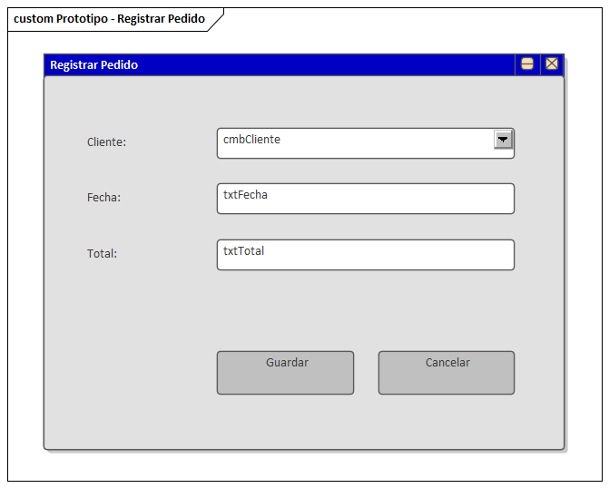
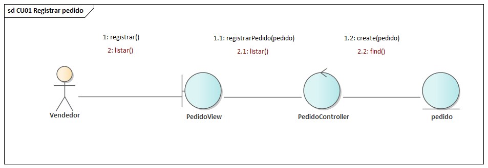
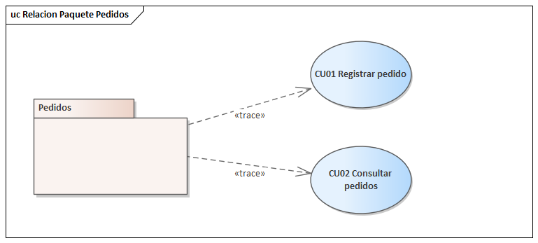
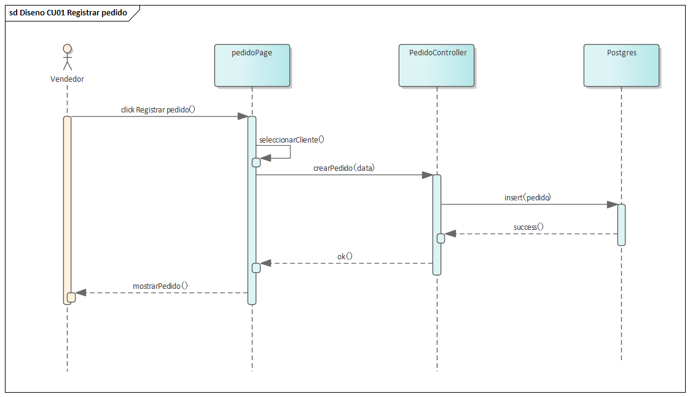
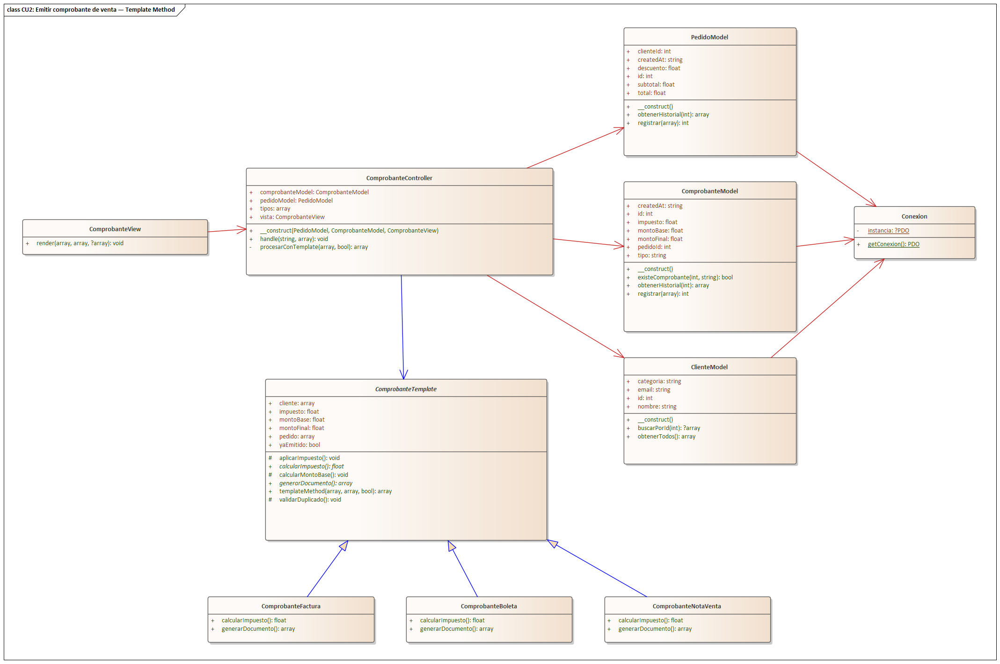
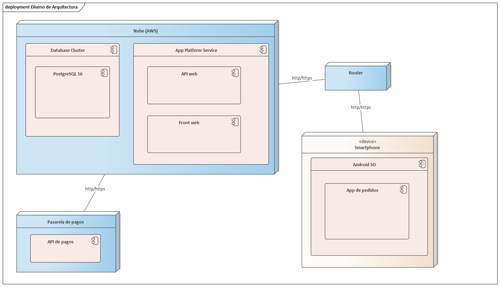
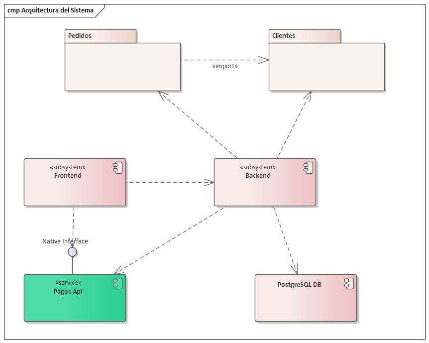
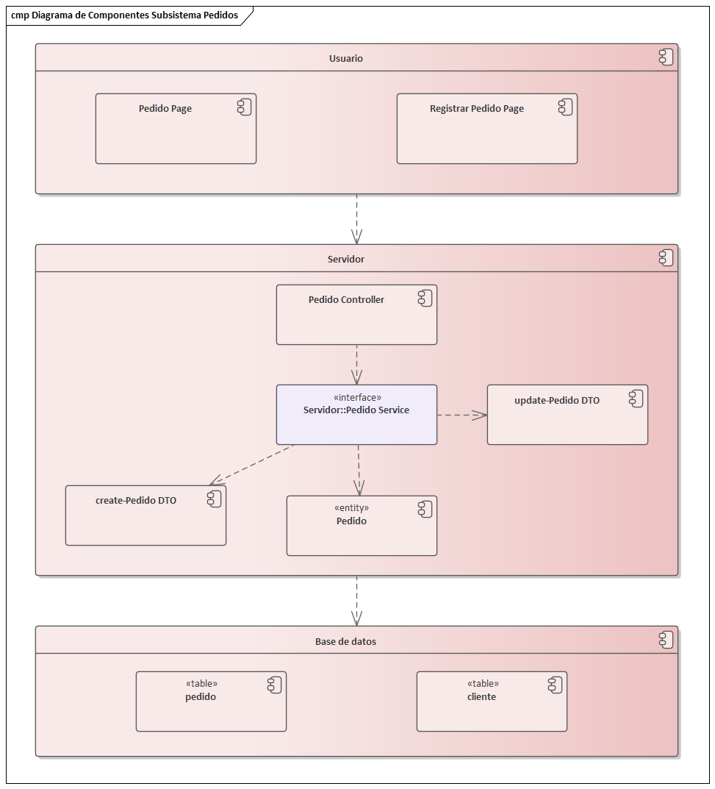

# diagramas-uml-ea

[](https://github.com/hebertsb/diagramas-uml-ea/stargazers)
[](https://creativecommons.org/licenses/by-nc-nd/4.0/deed.es)


> ⭐ **¿Te ahorró horas de diagramas? Dale una estrella al repositorio** (botón **Star**, arriba a la derecha). Así más estudiantes y equipos la encuentran.

Skill para agentes de programación (**Claude Code, Codex, Gemini CLI, Antigravity, OpenCode, Cursor** y cualquiera que use el formato abierto `SKILL.md`) que construye diagramas UML **reales y editables** en **Sparx Enterprise Architect** (archivo `.eapx`), a partir de la documentación y el código de tu proyecto. No genera imágenes sueltas: crea elementos y conectores que puedes abrir, mover y corregir en EA.

**Autor:** Hebert Suárez Burgos · **Licencia:** [CC BY-NC-ND 4.0](#licencia)

## Contenido

1. [Diagramas que genera](#diagramas-que-genera)
2. [Qué versión usar en tu documentación](#qué-versión-usar-en-tu-documentación)
3. [Modelo organizado por fases](#modelo-organizado-por-fases-proceso-unificado)
4. [Requisitos](#requisitos)
5. [Instalación](#instalación)
6. [Uso](#uso)
7. [Galería de ejemplos](#galería-de-ejemplos)
8. [Licencia](#licencia)

## Diagramas que genera

| Fase | Diagrama | Qué contiene |
|---|---|---|
| **Requisitos** | Requisitos | Requisitos funcionales y no funcionales trazados a los casos de uso |
| | Casos de uso | Global y por caso de uso, con `include` y `extend` |
| | Actividad | Calles (responsables), decisiones, inicio y fin |
| | Prototipos de interfaz | Pantallas con sus controles (etiquetas, campos, listas, botones) |
| **Análisis** | Modelo de dominio (conceptual) | Clases del negocio con atributos `+` y clave primaria; sin claves foráneas ni tipos |
| | Comunicación de análisis | Boundary, control y entity con mensajes numerados `1`, `1.1`, `1.2`... |
| | Robustez ICONIX | Boundary, control y entity con las reglas de conexión de ICONIX, sin mensajes |
| | Secuencia de análisis | Participantes en círculos (boundary, control, entity), mensajes del negocio |
| | Paquetes | Paquetes de análisis, relación con sus casos de uso (`«trace»`) y dependencias (`«import»`) |
| **Diseño** | Clases de diseño | Atributos con tipo, operaciones, herencia, composición y multiplicidades |
| | Secuencia de diseño | Participantes en cajas con las clases reales, métodos con parámetros y retornos; `alt`, `opt`, `loop` |
| | Modelo de datos lógico | Tablas y relaciones con cardinalidad; sin claves foráneas ni tipos |
| | Modelo de datos físico | Tablas con PK, FK y tipos de dato |
| | Navegación web (WAE) | Uno por actor: páginas cliente, formularios, páginas servidor y tablas |
| | Despliegue | Nube, router, servicios externos y dispositivos, con los componentes que corren dentro de cada uno |
| | Estados y objetos | Según el comportamiento real del sistema |
| | Patrones de diseño | Chain of Responsibility, Strategy, Template Method, Singleton: versión genérica y aplicada al caso de uso |
| **Implementación** | Arquitectura del sistema | Subsistemas, paquetes, servicios externos y base de datos |
| | Componentes por subsistema | Usuario (páginas) → Servidor (controller, service, DTO, entity) → Base de datos (tablas) |

## Qué versión usar en tu documentación

Algunos diagramas tienen **dos versiones**, porque cada docente pide una distinta. La skill genera ambas y tú incluyes en tu documento la que corresponda.

### Secuencia: análisis o diseño

| | Secuencia de análisis (ICONIX) | Secuencia de diseño |
|---|---|---|
| Propósito | Entender el caso de uso antes de diseñar; se deriva del diagrama de robustez | Mostrar cómo se va a programar; es la que suele pedirse en **taller de grado** |
| Participantes | Círculos: boundary, control y entity | Cajas con las clases reales: página o vista → controlador → servicio → base de datos |
| Mensajes | Lenguaje del negocio (`Obtener sugerencia()`) | Métodos reales con parámetros (`crearPedido(data)`), retornos punteados y autollamadas |
| Cuándo usarla | Metodología ICONIX o fase de análisis | Fase de diseño o implementación |

### Comunicación o robustez

Los dos usan los mismos elementos (actor, boundary, control y entity) y las mismas reglas de conexión. La **robustez** (ICONIX) muestra solo quién participa, sin mensajes. La **comunicación de análisis** (Proceso Unificado; en UML 1.x se llamaba "de colaboración") agrega los pasos del caso de uso como mensajes numerados.

### Modelo de datos: lógico o físico

| Diagrama | Llaves foráneas | Tipos de dato | Cuándo usarlo |
|---|---|---|---|
| Modelo de dominio (mapeo conceptual) | No | No | Análisis: las clases del negocio |
| Clases de diseño | No (la asociación la representa) | Sí | Diseño: las clases del código |
| Modelo de datos lógico | No (la línea con su cardinalidad la representa) | No | Estructura de la base de datos sin detalles técnicos |
| Modelo de datos físico | Sí (`FK`) | Sí (`INT`, `VARCHAR`...) | Base de datos lista para crear las tablas |

## Modelo organizado por fases (Proceso Unificado)

Si tu materia usa el Proceso Unificado, la skill organiza el `.eapx` en carpetas **Análisis → Diseño → Implementación**, con un paquete por actividad:

| Fase | Paquetes |
|---|---|
| Análisis | Identificar Actores, Estructurar Casos de Uso, Detallar Casos de Uso, Analizar Casos de Uso (un diagrama de comunicación por caso de uso, con su mismo nombre), Identificar Paquetes, Relación de Paquetes y Casos de Uso, Encapsulamiento, Análisis de Paquetes, Modelo de Dominio |
| Diseño | Diseño de Clases, Diseño de BD (lógico y físico), Diseño de Casos de Uso, Diseño de Paquetes, Diseño de Arquitectura (despliegue) |
| Implementación | Arquitectura del Sistema, Arquitectura de Subsistemas |

Los diagramas quedan **relacionados entre sí**: cada actor, caso de uso o paquete se crea una sola vez y los demás diagramas lo reutilizan (si cambias un nombre, cambia en todos), y las fases se unen con relaciones `«trace»` e `«import»`. En otros proyectos, la skill organiza el modelo según lo que indique tu documentación.

## Requisitos

- **Windows** con **Windows PowerShell 5.1**.
- **Sparx Enterprise Architect** instalado (probado con EA 15; sirve la versión de prueba). La skill lo maneja por su interfaz COM.
- Un agente que lea skills `SKILL.md` y pueda **ejecutar comandos de PowerShell** en tu equipo (Claude Code, Codex, Gemini CLI, Antigravity, OpenCode, Cursor...).
- EA debe estar **cerrado** sobre el archivo que se va a modificar.

## Instalación

### Opción 1: cualquier agente, con un solo comando (recomendada)

Requiere [Node.js](https://nodejs.org). El instalador detecta qué agentes tienes y copia la skill en la carpeta correcta de cada uno:

```powershell
npx skills add hebertsb/diagramas-uml-ea          # en el proyecto actual
npx skills add hebertsb/diagramas-uml-ea -g       # global, para todos tus proyectos
npx skills add hebertsb/diagramas-uml-ea -a codex # solo para un agente concreto
```

### Opción 2: Claude Code, como plugin

```powershell
claude plugin marketplace add hebertsb/diagramas-uml-ea
claude plugin install diagramas-uml-ea@skills-hebert
```

(En la terminal de Claude Code también funciona con `/plugin ...`.) Para recibir nuevas versiones: `claude plugin marketplace update skills-hebert`.

### Opción 3: copiar la carpeta a mano

Copia `skills/diagramas-uml-ea/` (con el archivo `LICENSE`) en la carpeta de skills de tu agente:

| Agente | En el proyecto | Global (todos tus proyectos) |
|---|---|---|
| Claude Code | `.claude/skills/` | `~/.claude/skills/` |
| Codex (OpenAI) | `.codex/skills/` o `.agents/skills/` | `~/.codex/skills/` |
| Gemini CLI | `.gemini/skills/` | `~/.gemini/skills/` |
| Antigravity | `.agent/skills/` | `~/.gemini/antigravity/skills/` |
| OpenCode | `.opencode/skills/` | `~/.config/opencode/skills/` |

> Las rutas pueden cambiar entre versiones de cada agente; si no la detecta, revisa la documentación de tu agente o usa la opción 1, que se mantiene al día. `~` es tu carpeta de usuario (`C:\Users\<tu-usuario>`).

## Uso

Pídeselo a tu agente en lenguaje normal, por ejemplo:

- *"Créame los diagramas de casos de uso y de secuencia de este proyecto en Enterprise Architect."*
- *"Haz el diagrama de navegación de cada actor del sistema."*
- *"Agrega a mi .eapx el diagrama de robustez del CU-03 sin tocar los demás."*

La skill analiza la documentación y el código, te propone la lista de diagramas, trabaja **siempre sobre una copia** del `.eapx`, verifica que todo persista al reabrir y exporta los PNG para revisarlos.

## Galería de ejemplos

Todas las imágenes son exportaciones directas de Enterprise Architect, generadas por la skill con proyectos de ejemplo.

### Requisitos y casos de uso

<table>
<tr>
<td width="50%" valign="top"><b>Casos de uso</b><br>Actores, casos de uso y relaciones <code>include</code>/<code>extend</code>.<br></td>
<td width="50%" valign="top"><b>Prototipo de interfaz</b><br>Pantalla con etiquetas, campos, lista desplegable y botones.<br></td>
</tr>
</table>

### Análisis

<table>
<tr>
<td width="50%" valign="top"><b>Comunicación de análisis</b><br>Pasos del caso de uso numerados por grupo (<code>1</code>, <code>1.1</code>, <code>1.2</code>).<br></td>
<td width="50%" valign="top"><b>Robustez ICONIX</b><br>Los mismos elementos, sin mensajes.<br></td>
</tr>
<tr>
<td width="50%" valign="top"><b>Secuencia de análisis</b><br>Participantes en círculos y fragmento <code>alt</code>.<br></td>
<td width="50%" valign="top"><b>Relación paquete – casos de uso</b><br>Paquete de análisis unido a sus casos de uso con <code>«trace»</code>.<br></td>
</tr>
</table>

### Diseño

<table>
<tr>
<td colspan="2" valign="top"><b>Navegación web (WAE)</b><br>Uno por actor: páginas cliente, formularios, páginas servidor (<code>ps</code>) y tablas, con enlaces <code>link</code>, <code>submit</code>, <code>build</code> y <code>access</code>.<br></td>
</tr>
<tr>
<td width="50%" valign="top"><b>Secuencia de diseño</b><br>Clases reales, métodos con parámetros, retornos y autollamadas.<br></td>
<td width="50%" valign="top"><b>Patrón de diseño aplicado</b><br>Template Method en el diagrama de clases de un caso de uso concreto.<br></td>
</tr>
<tr>
<td width="50%" valign="top"><b>Modelo de datos lógico</b><br>Sin claves foráneas ni tipos; la relación es la línea con su cardinalidad.<br></td>
<td width="50%" valign="top"><b>Modelo de datos físico</b><br>Con PK, FK y tipos de dato.<br></td>
</tr>
<tr>
<td colspan="2" valign="top"><b>Despliegue</b><br>Nodos, dispositivos y los componentes que corren dentro de cada uno, con enlaces <code>http/https</code>.<br></td>
</tr>
</table>

### Implementación

<table>
<tr>
<td width="50%" valign="top"><b>Arquitectura del sistema</b><br>Subsistemas, paquetes con <code>«import»</code>, servicio externo y base de datos.<br></td>
<td width="50%" valign="top"><b>Componentes de un subsistema</b><br>Usuario → Servidor → Base de datos.<br></td>
</tr>
</table>

## Licencia

Copyright (c) 2026 Hebert Suárez Burgos.

Esta obra está bajo la licencia **[Creative Commons Atribución-NoComercial-SinDerivadas 4.0 Internacional (CC BY-NC-ND 4.0)](https://creativecommons.org/licenses/by-nc-nd/4.0/deed.es)**. Texto completo en [`LICENSE`](LICENSE).

| Permitido | No permitido |
|---|---|
| ✅ Usarla para tus proyectos y los de tu equipo, gratis | ❌ Publicar o distribuir una versión **modificada** |
| ✅ Instalarla en tu máquina o dentro de tu proyecto | ❌ Presentarla como obra propia o quitar el crédito |
| ✅ Compartirla **sin cambios**, con el crédito al autor y esta licencia | ❌ Venderla o usarla en un producto o servicio de pago |
| ✅ Adaptarla para tu uso privado, sin publicar esa versión | |

¿Necesitas otro uso (comercial, una versión adaptada para tu institución)? Escríbeme abriendo un *issue*.

## Contribuir

¿Encontraste un error o tienes una mejora? Abre un **issue** o envía un **pull request** a este repositorio. Las mejoras aceptadas se publican aquí, con crédito a quien las aporte.

## ¿Te sirvió?

- ⭐ Dale una **estrella** al repositorio.
- 👀 Pulsa **Watch → Releases** para enterarte de las nuevas versiones.
- 💬 Compártela con tu curso o tu equipo y cuéntame en un *issue* qué diagramas hiciste con ella.
