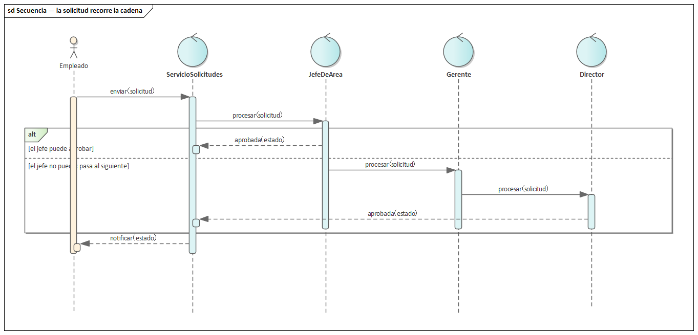

# diagramas-uml-ea

[](https://github.com/hebertsb/diagramas-uml-ea/stargazers)
[](https://creativecommons.org/licenses/by-nc-nd/4.0/deed.es)


> ⭐ **¿Te ahorró horas de diagramas? Dale una estrella al repositorio** (botón **Star**, arriba a la derecha). Así más estudiantes y equipos la encuentran.

Skill para **Claude Code** que construye diagramas UML **reales y editables** en **Sparx Enterprise Architect** (archivo `.eapx`), leyendo la documentación y el código de tu proyecto. No genera imágenes sueltas: crea elementos y conectores que puedes abrir, mover y corregir en EA.

**Autor:** Hebert Suárez Burgos · **Licencia:** [CC BY-NC-ND 4.0](#licencia)


## Qué diagramas genera

| Diagrama | Detalle |
|---|---|
| Casos de uso | Global y por caso de uso, con `include`/`extend` |
| Actividad | Con calles (responsables), decisiones, inicio y fin |
| Secuencia | Con fragmentos `alt`, `opt`, `loop`; orden de mensajes verificado |
| Comunicación | Mensajes numerados, coherentes con la secuencia |
| Clases de diseño | Atributos con tipo, operaciones, herencia, composición, multiplicidades |
| Modelo de dominio (conceptual) | Atributos con `+` y clave primaria; sin claves foráneas ni tipos |
| Modelo de datos | Tablas, columnas, claves primarias y foráneas |
| Robustez ICONIX | Boundary, control y entity, con las reglas de conexión de ICONIX |
| **Navegación web (WAE)** | Uno por actor: páginas cliente, formularios, páginas servidor y tablas (`link`, `submit`, `build`, `access`) |
| Prototipos de interfaz | Pantallas con sus controles |
| Requisitos | RF/RNF trazados a los casos de uso |
| Objetos, estados, paquetes, componentes, despliegue | Según la arquitectura real |
| Patrones de diseño | Chain of Responsibility, Strategy, Template Method, Singleton: genérico + específico del caso de uso |

<p>


</p>
<p>


</p>

## Requisitos

- **Windows** con **Windows PowerShell 5.1**.
- **Sparx Enterprise Architect** instalado (probado con EA 15; sirve la versión de prueba). La skill lo maneja por su interfaz COM.
- **Claude Code**.
- EA debe estar **cerrado** sobre el archivo que se va a modificar.

## Instalación

### Opción 1: como plugin (recomendada)

Dentro de Claude Code:

```text
/plugin marketplace add hebertsb/diagramas-uml-ea
/plugin install diagramas-uml-ea@skills-hebert
```

Para recibir nuevas versiones: `/plugin marketplace update skills-hebert`.

### Opción 2: copiar la carpeta

Copia `skills/diagramas-uml-ea/` (con el archivo `LICENSE`) en:

- `C:\Users\<tu-usuario>\.claude\skills\` para tenerla en todos tus proyectos, o
- `<tu-proyecto>\.claude\skills\` para que la tenga todo tu equipo al clonar el repositorio.

## Uso

Pídeselo a Claude Code en lenguaje normal, por ejemplo:

- *"Créame los diagramas de casos de uso y de secuencia de este proyecto en Enterprise Architect."*
- *"Haz el diagrama de navegación de cada actor del sistema."*
- *"Agrega a mi .eapx el diagrama de robustez del CU-03 sin tocar los demás."*

La skill analiza la documentación y el código, te propone la lista de diagramas, trabaja **siempre sobre una copia** del `.eapx`, verifica que todo persista al reabrir y exporta los PNG para revisarlos.

## Licencia

Copyright (c) 2026 Hebert Suárez Burgos.

Esta obra está bajo la licencia **[Creative Commons Atribución-NoComercial-SinDerivadas 4.0 Internacional (CC BY-NC-ND 4.0)](https://creativecommons.org/licenses/by-nc-nd/4.0/deed.es)**. Texto completo en [`LICENSE`](LICENSE).

| | |
|---|---|
| ✅ Usarla para tus proyectos y los de tu equipo, gratis | ✅ Instalarla en tu máquina o dentro de tu proyecto |
| ✅ Compartirla **sin cambios**, con el crédito al autor y esta licencia | ✅ Adaptarla para tu uso privado, sin publicar esa versión |
| ❌ Publicar o distribuir una versión **modificada** | ❌ Presentarla como obra propia o quitar el crédito |
| ❌ Venderla o usarla en un producto o servicio de pago | |

¿Necesitas otro uso (comercial, una versión adaptada para tu institución)? Escríbeme abriendo un *issue*.

## Contribuir

¿Encontraste un error o tienes una mejora? Abre un **issue** o envía un **pull request** a este repositorio. Las mejoras aceptadas se publican aquí, con crédito a quien las aporte.

## ¿Te sirvió?

- ⭐ Dale una **estrella** al repositorio.
- 👀 Pulsa **Watch → Releases** para enterarte de las nuevas versiones.
- 💬 Compártela con tu curso o tu equipo y cuéntame en un *issue* qué diagramas hiciste con ella.
