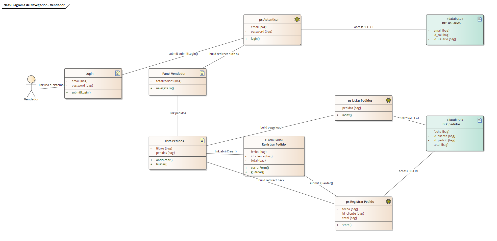
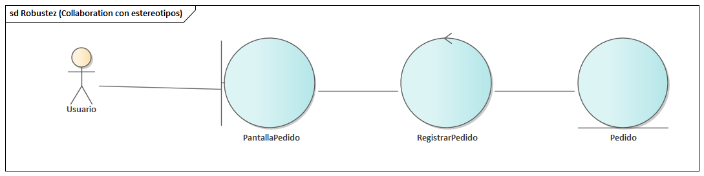
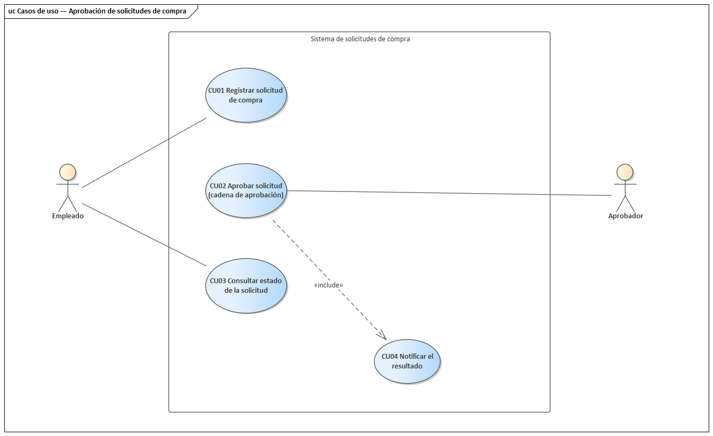
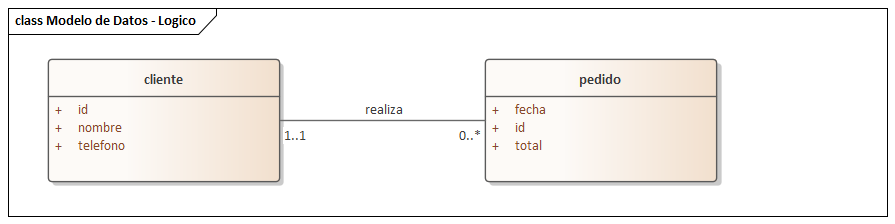
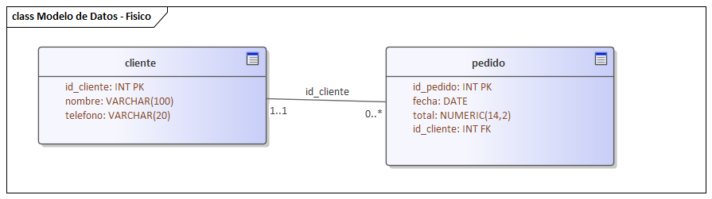
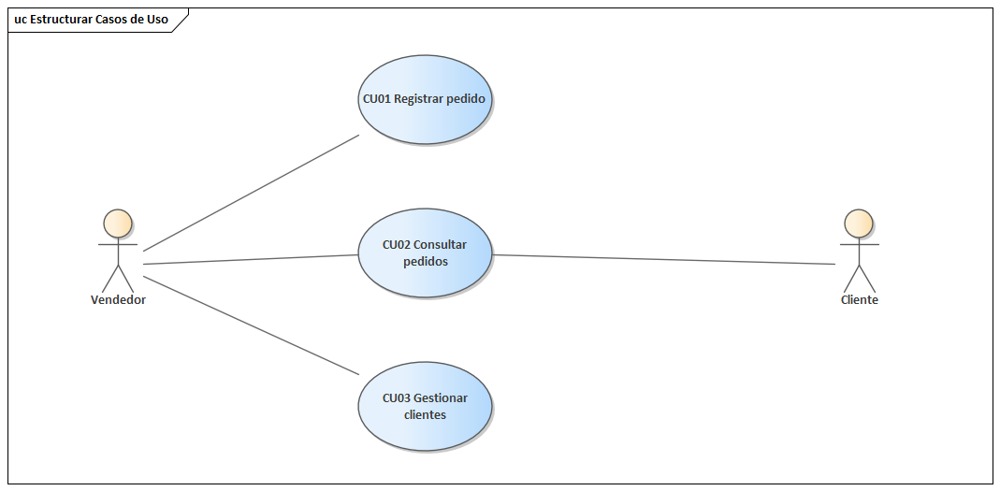

# diagramas-uml-ea

[](https://github.com/hebertsb/diagramas-uml-ea/stargazers)
[](https://creativecommons.org/licenses/by-nc-nd/4.0/deed.es)


> ⭐ **¿Te ahorró horas de diagramas? Dale una estrella al repositorio** (botón **Star**, arriba a la derecha). Así más estudiantes y equipos la encuentran.

Skill para agentes de programación (**Claude Code, Codex, Gemini CLI, Antigravity, OpenCode, Cursor** y cualquiera que use el formato abierto `SKILL.md`) que construye diagramas UML **reales y editables** en **Sparx Enterprise Architect** (archivo `.eapx`), leyendo la documentación y el código de tu proyecto. No genera imágenes sueltas: crea elementos y conectores que puedes abrir, mover y corregir en EA.

**Autor:** Hebert Suárez Burgos · **Licencia:** [CC BY-NC-ND 4.0](#licencia)



## Qué diagramas genera

| Diagrama | Detalle |
|---|---|
| Casos de uso | Global y por caso de uso, con `include`/`extend` |
| Actividad | Con calles (responsables), decisiones, inicio y fin |
| Secuencia de **análisis** y de **diseño** | Dos variantes (ver abajo); fragmentos `alt`, `opt`, `loop`; orden de mensajes verificado |
| Comunicación (antes "colaboración") | Mensajes numerados `1`, `1.1`, `1.2`..., coherentes con la secuencia; versión de análisis con boundary, control y entity |
| Clases de diseño | Atributos con tipo, operaciones, herencia, composición, multiplicidades |
| Modelo de dominio (conceptual) | Atributos con `+` y clave primaria; sin claves foráneas ni tipos |
| Modelo de datos **lógico** y **físico** | Los dos, sobre las mismas tablas (ver abajo) |
| Robustez ICONIX | Boundary, control y entity, con las reglas de conexión de ICONIX |
| **Navegación web (WAE)** | Uno por actor: páginas cliente, formularios, páginas servidor y tablas (`link`, `submit`, `build`, `access`) |
| Prototipos de interfaz | Pantallas con sus controles |
| Requisitos | RF/RNF trazados a los casos de uso |
| Objetos, estados, paquetes, componentes, despliegue | Según la arquitectura real |
| Patrones de diseño | Chain of Responsibility, Strategy, Template Method, Singleton: genérico + específico del caso de uso |

<p>


</p>
<p>


</p>

## Qué diagrama usar en tu documentación

Algunos diagramas tienen **dos versiones**, porque cada docente pide una distinta. La skill genera las dos y tú pones en tu documento la que te pidan.

### Secuencia: análisis o diseño

| | **Secuencia de análisis** (ICONIX) | **Secuencia de diseño** |
|---|---|---|
| Para qué sirve | Entender el caso de uso antes de diseñar; sale del diagrama de robustez | Mostrar cómo se va a programar; es la que suelen pedir en **taller de grado** |
| Participantes | **Círculos**: boundary, control y entity | **Cajitas** con las clases reales: página o vista → controlador → servicio → base de datos |
| Mensajes | En lenguaje del negocio (`Obtener sugerencia()`) | Métodos reales con parámetros (`crearPedido(data)`), retornos punteados (`ok()`), autollamadas |
| ¿Cuándo usarla? | Si tu metodología es ICONIX o te piden análisis | Si te piden el diseño o la implementación |

<p>

</p>

### Modelo de datos: lógico o físico

| Diagrama | Llaves foráneas | Tipos de dato | ¿Cuándo usarlo? |
|---|---|---|---|
| Modelo de dominio (mapeo conceptual) | ❌ No | ❌ No | Análisis: las clases del negocio |
| Diagrama de clases de diseño | ❌ No (la asociación la representa) | ✅ Sí | Diseño: las clases del código |
| **Modelo de datos lógico** | ❌ No (la **línea** con su cardinalidad la representa) | ❌ No | Cuando piden la estructura de la BD "estilo clases" |
| **Modelo de datos físico** | ✅ Sí (`FK`) | ✅ Sí (`INT`, `VARCHAR`...) | Cuando piden la BD lista para crear las tablas |

<p>


</p>

### Modelo organizado por fases (Proceso Unificado)

Si tu materia usa el Proceso Unificado, la skill arma el `.eapx` en carpetas **Análisis → Diseño → Implementación**, con un paquete por actividad (Identificar Actores, Estructurar Casos de Uso, Detallar, Analizar, Identificar Paquetes, Encapsulamiento, Modelo de Dominio; Diseño de Clases, de BD, de CU, de Paquetes, de Arquitectura; Arquitectura del Sistema y de Subsistemas).

En **Analizar Casos de Uso** va, por cada caso de uso, un diagrama de **comunicación de análisis** con el mismo nombre del caso de uso (por ejemplo `CU01 Registrar pedido`): actor, boundary, control y entity con los mensajes numerados. Es el diagrama que en UML 1.x se llamaba "de colaboración". Si tu metodología es ICONIX, en su lugar va el de robustez, sin mensajes.

<p>

</p>

Los diagramas quedan **relacionados entre sí**: cada actor, caso de uso o paquete se crea una sola vez y los demás diagramas lo reutilizan (si cambias un nombre, cambia en todos), y las fases se unen con relaciones `«trace»`, `«import»` y de realización. En otros proyectos, la skill organiza el modelo según lo que diga tu documentación.

<p>


</p>

## Requisitos

- **Windows** con **Windows PowerShell 5.1**.
- **Sparx Enterprise Architect** instalado (probado con EA 15; sirve la versión de prueba). La skill lo maneja por su interfaz COM.
- Un agente que lea skills `SKILL.md` y pueda **ejecutar comandos de PowerShell** en tu equipo (Claude Code, Codex, Gemini CLI, Antigravity, OpenCode, Cursor...).
- EA debe estar **cerrado** sobre el archivo que se va a modificar.

## Instalación

### Opción 1: cualquier agente, con un solo comando (recomendada)

Requiere [Node.js](https://nodejs.org). El instalador detecta qué agentes tienes y copia la skill en la carpeta correcta de cada uno:

```powershell
npx skills add hebertsb/diagramas-uml-ea          # en el proyecto actual
npx skills add hebertsb/diagramas-uml-ea -g       # global, para todos tus proyectos
npx skills add hebertsb/diagramas-uml-ea -a codex # solo para un agente concreto
```

### Opción 2: Claude Code, como plugin

```powershell
claude plugin marketplace add hebertsb/diagramas-uml-ea
claude plugin install diagramas-uml-ea@skills-hebert
```

(En la terminal de Claude Code también funciona con `/plugin ...`.) Para recibir nuevas versiones: `claude plugin marketplace update skills-hebert`.

### Opción 3: copiar la carpeta a mano

Copia `skills/diagramas-uml-ea/` (con el archivo `LICENSE`) en la carpeta de skills de tu agente:

| Agente | En el proyecto | Global (todos tus proyectos) |
|---|---|---|
| Claude Code | `.claude/skills/` | `~/.claude/skills/` |
| Codex (OpenAI) | `.codex/skills/` o `.agents/skills/` | `~/.codex/skills/` |
| Gemini CLI | `.gemini/skills/` | `~/.gemini/skills/` |
| Antigravity | `.agent/skills/` | `~/.gemini/antigravity/skills/` |
| OpenCode | `.opencode/skills/` | `~/.config/opencode/skills/` |

> Las rutas pueden cambiar entre versiones de cada agente; si no la detecta, revisa la documentación de tu agente o usa la opción 1, que se mantiene al día. `~` es tu carpeta de usuario (`C:\Users\<tu-usuario>`).

## Uso

Pídeselo a tu agente en lenguaje normal, por ejemplo:

- *"Créame los diagramas de casos de uso y de secuencia de este proyecto en Enterprise Architect."*
- *"Haz el diagrama de navegación de cada actor del sistema."*
- *"Agrega a mi .eapx el diagrama de robustez del CU-03 sin tocar los demás."*

La skill analiza la documentación y el código, te propone la lista de diagramas, trabaja **siempre sobre una copia** del `.eapx`, verifica que todo persista al reabrir y exporta los PNG para revisarlos.

## Licencia

Copyright (c) 2026 Hebert Suárez Burgos.

Esta obra está bajo la licencia **[Creative Commons Atribución-NoComercial-SinDerivadas 4.0 Internacional (CC BY-NC-ND 4.0)](https://creativecommons.org/licenses/by-nc-nd/4.0/deed.es)**. Texto completo en [`LICENSE`](LICENSE).

| | |
|---|---|
| ✅ Usarla para tus proyectos y los de tu equipo, gratis | ✅ Instalarla en tu máquina o dentro de tu proyecto |
| ✅ Compartirla **sin cambios**, con el crédito al autor y esta licencia | ✅ Adaptarla para tu uso privado, sin publicar esa versión |
| ❌ Publicar o distribuir una versión **modificada** | ❌ Presentarla como obra propia o quitar el crédito |
| ❌ Venderla o usarla en un producto o servicio de pago | |

¿Necesitas otro uso (comercial, una versión adaptada para tu institución)? Escríbeme abriendo un *issue*.

## Contribuir

¿Encontraste un error o tienes una mejora? Abre un **issue** o envía un **pull request** a este repositorio. Las mejoras aceptadas se publican aquí, con crédito a quien las aporte.

## ¿Te sirvió?

- ⭐ Dale una **estrella** al repositorio.
- 👀 Pulsa **Watch → Releases** para enterarte de las nuevas versiones.
- 💬 Compártela con tu curso o tu equipo y cuéntame en un *issue* qué diagramas hiciste con ella.
